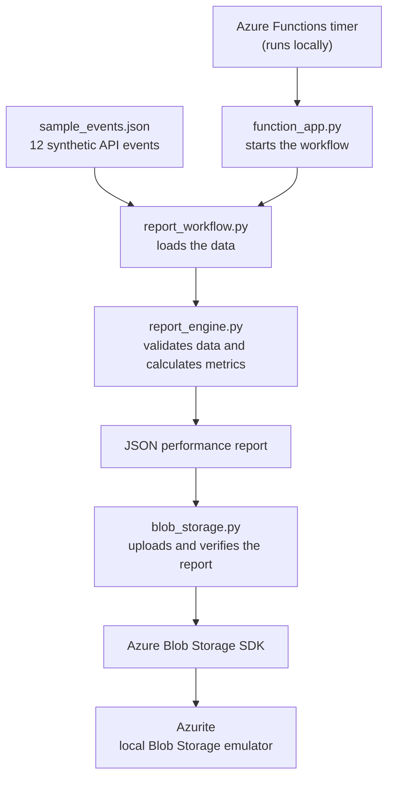

# Azure Cloud Automation & Deployment

**Automated SaaS performance reporting using Python and Azure-compatible tools.**

> **Project status:** Working local prototype. Built with Azure Functions Core Tools and Azurite; **not deployed to Microsoft Azure**.

## Project Overview

A software company needs to know whether its online services are working reliably. Reviewing individual API events by hand takes time and makes it harder to spot performance problems.

I built an automated reporting workflow that checks sample API events, calculates performance metrics, creates a JSON report, and uploads the report to local Azure-compatible storage. An Azure Functions timer runs the process on a schedule.

**Business value:** This approach can reduce repetitive reporting work and provide consistent performance information for engineering teams.

## Architecture



**In plain English:** A scheduled task starts the process. Python checks the data and summarises service performance. The results are saved as a report, uploaded to a local storage emulator, and checked to confirm the upload succeeded.

## Technologies Used

| Technology | Purpose |
| --- | --- |
| Python 3.12 | Process data and generate reports |
| Azure Functions Core Tools | Run the scheduled function locally |
| Azure Storage Blob SDK | Upload and verify reports |
| Azurite | Emulate Azure Blob Storage on a local computer |
| pytest | Automatically test validation, calculations and error handling |
| Git and GitHub | Track changes and publish the project |

## What the System Does

1. Reads 12 synthetic API events from `data/sample_events.json`.
2. Validates required fields, timestamps and duplicate event IDs.
3. Calculates total requests, successful requests, success percentage and average response time.
4. Generates a JSON report with overall and per-service metrics.
5. Uploads the report to an Azurite Blob Storage container and verifies that it exists.
6. Runs automatically through a local Azure Functions timer trigger.

## Project Structure

| File or folder | Responsibility |
| --- | --- |
| `function_app.py` | Azure Functions triggers and scheduled workflow |
| `report_engine.py` | Input validation and performance calculations |
| `report_workflow.py` | Report generation and JSON output |
| `blob_storage.py` | Blob upload and verification |
| `data/sample_events.json` | Synthetic example API data |
| `tests/` | Automated pytest tests |
| `requirements.txt` | Python application dependencies |
| `experiments/` | Earlier exploratory code |

## Testing and Results

The local test suite passed **8 out of 8 tests**. It checks event validation, invalid or missing fields, duplicate event IDs, performance calculations, JSON report creation and missing-file error handling.

A separate local integration run also confirmed that the scheduled function could generate a report and upload it to Azurite.

Run the tests from the project folder:

```bash
python3.12 -m pytest tests/ -v
```

**Note:** These tests demonstrate the local prototype; they do not establish production readiness or a successful deployment to live Azure.

## How to Run Locally

**Prerequisites:** Python 3.12, Azure Functions Core Tools v4, Azurite and pytest.

**1. Install the Python dependencies** in the project folder:

```bash
python3.12 -m venv .venv
source .venv/bin/activate
python -m pip install -r requirements.txt
python -m pip install pytest
```

**2. Create `local.settings.json`** in the project folder (do not commit this file to Git):

```json
{
  "IsEncrypted": false,
  "Values": {
    "AzureWebJobsStorage": "UseDevelopmentStorage=true",
    "FUNCTIONS_WORKER_RUNTIME": "python"
  }
}
```

**3. Start Azurite** in a separate terminal, using your installed Azurite command or VS Code extension.

**4. Start the Azure Functions host** from the project folder:

```bash
func start
```

The timer is configured to run every five minutes. Check the terminal logs, the generated report in `reports/`, and the uploaded blob in Azurite's `saas-performance-report` container.

## Security and Limitations

- The example events are synthetic, not real customer data.
- Local configuration and generated files should be excluded from Git.
- Azurite is a local emulator, not live Azure storage.
- The prototype has not been deployed or independently security-tested for production use.

## Possible Future Improvements

- Add a GitHub Actions workflow to run tests on each push.
- Deploy the solution to a real Azure environment with secure configuration.
- Add monitoring, alerting and more integration tests.

## Evidence

Local testing confirmed **8 passing pytest tests** and a successful upload to Azurite. Screenshots of the test output, Azure Functions logs and verified upload can be added to an `assets/` folder before publication.